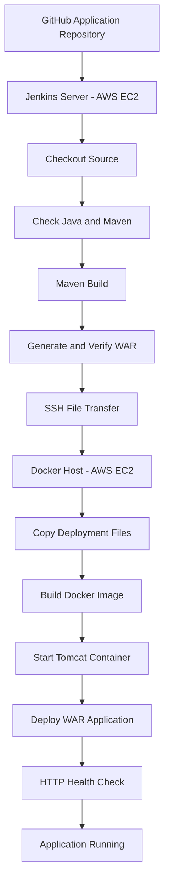

# Jenkins CI/CD Pipeline for Dockerized Tomcat Deployment

A hands-on DevOps project that automates the build, transfer, and deployment of a Java web application using Jenkins, Maven, Docker, Apache Tomcat, and AWS EC2.

The pipeline builds a WAR artifact, transfers it to a remote Docker host over SSH, creates a Docker image, deploys the application in Tomcat, and verifies the deployment through an HTTP health check.

## 1. Project Overview

This project demonstrates an end-to-end CI/CD workflow with two AWS EC2 instances:

- **Jenkins Server:** Automates source checkout, application build, artifact verification, and deployment.
- **Docker Host:** Receives deployment files, builds the Docker image, and runs the Tomcat container.

The pipeline is designed to reduce manual deployment steps and provide a repeatable deployment process.

**Application source:** [iamsaketranjan/hello-world](https://github.com/iamsaketranjan/hello-world)

The application source is a separate sample project. This repository contains the CI/CD pipeline and deployment configuration.

## 2. Architecture



### Deployment flow

1. Jenkins retrieves the application source code from GitHub.
2. Maven builds the application and generates a WAR file.
3. Jenkins verifies that the WAR artifact exists.
4. Publish Over SSH transfers the WAR and Docker configuration to the Docker host.
5. The Docker host builds the application image.
6. The previous application container is replaced with a new container.
7. A local HTTP health check verifies that the application responds successfully.

## 3. Technology Stack

| Technology | Purpose |
|---|---|
| Git and GitHub | Source control and repository hosting |
| Jenkins | CI/CD pipeline automation |
| Java | Java application build and runtime |
| Apache Maven | Application compilation and WAR packaging |
| AWS EC2 | Hosts Jenkins and the Docker deployment server |
| SSH | Secure remote communication and file transfer |
| Publish Over SSH | Jenkins-to-Docker-host file transfer and remote execution |
| Docker | Image creation and container deployment |
| Apache Tomcat | Java web application server |
| PowerShell | Local development and repository management |

## 4. Jenkins Pipeline

The pipeline is defined in the `Jenkinsfile`.

| Stage | Description |
|---|---|
| Checkout | Clones the application source repository |
| Check Tools | Checks Java and Maven versions |
| Build WAR | Executes `mvn clean package` |
| Verify WAR | Confirms that the WAR artifact was generated |
| Transfer and Deploy | Transfers deployment files, builds the image, starts the container, and verifies the application |

### Build command

```bash
mvn clean package
```

### Deployment configuration

The deployment stage uses Jenkins Publish Over SSH to communicate with the Docker host.

The configured SSH server name in Jenkins is:

```text
dockerhost
```

The pipeline transfers:

- The generated WAR file.
- The Dockerfile.
- The Tomcat Manager context configuration.

The actual Tomcat credentials file is provisioned separately on the Docker host.

## 5. Repository Structure

```text
jenkins-docker-tomcat-cicd/
│
├── Jenkinsfile
├── README.md
├── .gitignore
│
├── docker/
│   ├── Dockerfile
│   ├── manager-context.xml
│   └── tomcat-users.xml.example
│
└── docs/
    └── architecture.md
```

### Important files

| File | Responsibility |
|---|---|
| `Jenkinsfile` | Defines the CI/CD pipeline |
| `docker/Dockerfile` | Defines the Tomcat Docker image |
| `docker/manager-context.xml` | Configures Tomcat Manager access |
| `docker/tomcat-users.xml.example` | Provides a sanitized credentials template |
| `docs/architecture.md` | Explains the deployment architecture |
| `.gitignore` | Excludes credentials and generated build artifacts |

## 6. Infrastructure Requirements

The AWS lab uses two EC2 instances.

### Jenkins Server

Required configuration:

- Jenkins installed and running.
- Java installed.
- Maven available at `/opt/maven`.
- Pipeline support enabled.
- Publish Over SSH plugin installed.
- SSH authentication configured for the Docker host.

### Docker Host

Required configuration:

- Amazon Linux 2023.
- Docker Engine installed and running.
- SSH access configured for the Jenkins deployment user.
- Deployment directory at `/opt/docker`.
- Tomcat credentials file provisioned at `/opt/docker/tomcat-users.xml`.

### Network requirements

- Jenkins must be able to connect to the Docker host over SSH.
- The application port must be allowed through the Docker host security group for browser access.
- SSH access should be restricted to trusted source addresses.

Do not expose Jenkins or SSH ports publicly without appropriate access controls.

## 7. Docker Deployment

The Dockerfile uses the Tomcat base image and performs the following operations:

1. Restores Tomcat's default web applications.
2. Copies the generated WAR file into Tomcat's web applications directory.
3. Configures the Tomcat Manager context.
4. Copies the Tomcat users configuration into the image.

### Container configuration

| Setting | Value |
|---|---|
| Docker image | `regapp:v2` |
| Container name | `registryapp` |
| Tomcat container port | `8080` |
| Host port | `8088` |
| Application context | `/webapp/` |

The application is accessed at:

```text
http://<DOCKER_HOST_PUBLIC_IP>:8088/webapp/
```

Replace the placeholder with the Docker host's public IP address while the instance is running.

## 8. Deployment Verification

The deployment was successfully tested in the AWS EC2 lab.

The following results were verified:

- Jenkins pipeline completed successfully.
- Maven generated the WAR artifact.
- Jenkins transferred the deployment files to the Docker host.
- Docker image `regapp:v2` was built.
- Container `registryapp` started successfully.
- Tomcat deployed the WAR application.
- The application endpoint returned HTTP `200 OK`.
- The registration page was accessible in a browser.

### Health check

The pipeline checks the application locally on the Docker host:

```bash
curl -fsS -o /dev/null http://localhost:8088/webapp/
```

The check retries up to ten times, with a three-second interval between attempts.

**Test scope:** Application deployment and HTTP availability were verified. Form submission and database persistence were not tested.

## 9. Security Considerations

- Private SSH keys must never be committed to the repository.
- Real usernames and passwords must not be stored in GitHub.
- `.gitignore` excludes `tomcat-users.xml` and other sensitive files.
- `tomcat-users.xml.example` contains placeholders, not working credentials.
- The actual Tomcat credentials file is maintained separately on the Docker host.

**Known security limitation:** The current Dockerfile copies `tomcat-users.xml` into the Docker image. Credentials are therefore included in the image layers. This is acceptable only as a learning-lab configuration, not as a production secrets-management practice.

A production implementation should inject secrets at runtime and use a dedicated secrets-management solution.

The project also uses the mutable `tomcat:latest` image tag. Pinning a tested version or image digest would improve reproducibility.

## 10. Limitations and Future Improvements

- Move application repository and branch settings into pipeline parameters.
- Improve secrets management and remove credentials from image layers.
- Pin the Docker base image version.
- Add automated application tests.
- Implement rollback for unsuccessful deployments.
- Add deployment notifications.
- Improve deployment availability with a safer container replacement strategy.
- Introduce a production-ready deployment process.

## 11. Learning Outcomes

This project provided practical experience with:

- Writing and executing Jenkins declarative pipelines.
- Building Java applications with Maven.
- Packaging and deploying WAR artifacts.
- Configuring SSH-based remote deployment.
- Using Docker to build images and manage containers.
- Configuring Apache Tomcat.
- Deploying applications on AWS EC2.
- Implementing HTTP-based deployment verification.
- Documenting CI/CD architecture and security limitations.

## 12. Project Status

**Core CI/CD deployment: Successfully tested in an AWS EC2 lab.**

The repository contains the pipeline definition, Docker configuration, and project documentation. Security hardening, rollback support, and additional automation remain future improvements.


